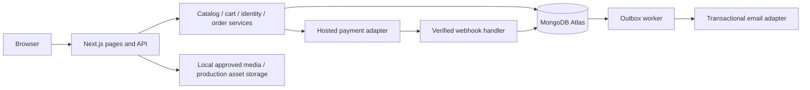

# OVIA — Architecture

Status: implementation baseline updated to the user's selected stack on 2026-09-21. The detailed model/operations sections below retain launch targets where noted. See [README](README.md) for implemented setup, [verification](VERIFICATION.md) for evidence, and [requirements](prd.md) for scope.

## Technical baseline

Implemented a TypeScript modular monolith: Next.js 16 App Router, React 19, REST route handlers, the official MongoDB Node driver, Zod boundary validation, CSS3, GSAP and Framer Motion. Authentication uses the user's JWT option through jose with scrypt password hashing and database-backed revocable sessions. Domain tests use Node's test runner through tsx; browser tests use Playwright. npm and package-lock.json pin the installed dependency tree. Vercel plus MongoDB Atlas is the deployment target.

Stripe and Razorpay sandbox adapters are implemented behind PAYMENT_PROVIDER, alongside a local demo checkout. Only test credentials are accepted. Signed webhooks confirm payments; no card details are collected by OVIA. Cloudinary URLs are supported for approved image delivery. An email outbox and configurable Resend dispatcher support verification/reset messages. External service connections have not been verified without credentials.



Server-rendered pages invoke services directly rather than making unnecessary HTTP requests to their own API. Client interactions use the same service layer through validated APIs. Public catalog responses can be cached; account, cart, checkout and order responses must not enter shared caches.

## Proposed layout

```text
src/app/                   pages, layouts, route handlers, error boundaries
src/components/            accessible primitives and storefront components
src/features/catalog/      queries, filters, mapping and presentation
src/features/cart/         cart service and UI
src/features/checkout/     quoting and payment orchestration
src/features/account/      identity, addresses and order ownership
src/server/                database, sessions, adapters, logging, jobs
src/content/               original editorial and service content
prisma/                    schema, migrations and deterministic seeds
scripts/                   catalog validation and permitted image import
public/media/products/     approved local derivative images
assets/provenance/         manifests and permission evidence references
tests/                     domain, integration, security and browser tests
```

## Data model

All mutable records have createdAt/updatedAt timestamps. IDs are opaque; database constraints enforce uniqueness and relationships.

| Entity | Essential fields and constraints |
|---|---|
| Product | id, unique slug, name, description, department, categoryId, collectionId, material, specs JSON, status draft/published/archived |
| Variant | id, productId, unique SKU, color, size, priceMinor >=0, currency INR, dimensions, weight, capacity; unique option combination per product |
| Inventory | variantId unique, onHand >=0, reserved >=0, reserved <=onHand, version |
| Category / Collection | unique slug, title, department or rule definition; allowlisted filter fields |
| ProductTag | productId/tag unique; travel/use-case and editorial associations |
| Asset | productId, optional variantId, localPath, alt, width, height, checksum, provenanceId, sortOrder |
| AssetProvenance | sourceUrl, author, license, licenseUrl, evidenceRef, acquiredAt, attribution, commercialUseAllowed, modificationAllowed, approvalStatus |
| Compatibility | accessoryVariantId, targetProductId, notes; unique pair |
| User / Session | normalized unique email, verification state, password hash if password auth, session token hash, expiresAt, revokedAt |
| Address | userId, recipient, address lines, city, region, postal code, country; ownership enforced |
| Cart / CartItem | opaque cart token hash or userId, expiry, version; item variantId, configuration hash, quantity >0; unique line key per cart |
| CheckoutAttempt | cartId, idempotencyKey unique per actor, quote snapshot, expiry, providerSessionId unique |
| InventoryReservation | attemptId, variantId, quantity, expiresAt, state held/released/consumed |
| Order / OrderItem | userId nullable, guest email, immutable address and SKU/name/price snapshots, amounts, currency, payment state, fulfillment state |
| PaymentEvent | provider/eventId unique, paymentId, processing state, receivedAt; minimal sanitized payload |
| Outbox | event type, recordId, deduplication key unique, retry count, nextAttemptAt, delivery state |
| ContactRequest | reference, validated message/contact data, delivery state, retention expiry |

The implemented seed creates unique record-ID, user-email and order owner/idempotency indexes. Variants are embedded in product documents; stock is a separate inventory collection. The 72-record catalog currently uses normalized in-memory matching after loading the catalog. Move filtering/pagination into MongoDB queries and add appropriate indexes before growing the catalog. The entity table above is a target model: compatibility, fulfillment tracking and a comprehensive audit log remain future work.

## API contract

All endpoints below use `/api/v1`. JSON success uses `{data, meta?}`; errors use `{error: {code, message, fieldErrors?, requestId}}`. No stack traces or secrets in responses. Pagination defaults to 24, maximum 48. Quantity is integer 1–10 and limited by inventory. Malformed inputs return 400, missing authentication 401, forbidden operations 403, absent/inaccessible owned resources 404 where appropriate, stock/version conflicts 409, throttling 429 and unexpected failures 500.

| Method / path | Access and behavior |
|---|---|
| GET `/products` | Public; allowlisted filters, sort and pagination; published products only |
| GET `/products/:slug` | Public; validated variant and asset data; 404 if unavailable |
| GET `/search?q=` | Public; bounded query length, paginated results and rate limits |
| GET `/collections/:slug` | Public; collection content and validated product selection |
| GET `/cart` | Session/guest cart cookie; returns server-calculated quote |
| POST `/cart/items` | CSRF protected; variantId, quantity, compatible configuration; 201 |
| PATCH `/cart/items/:id` | Owner only; quantity and expected cart version; 200 |
| DELETE `/cart/items/:id` | Owner only; 204, no JSON response body |
| POST `/checkout` | Owner of cart; address, shipping option and idempotency key; reserves stock and returns hosted checkout destination |
| GET `/orders/:id` | Signed-in owner or scoped guest proof; sanitized order details |
| GET `/account/orders` | Authenticated user; paginated owned orders |
| GET/POST `/account/addresses` | Owner-scoped list/create |
| PATCH/DELETE `/account/addresses/:id` | Owner-scoped update/delete |
| POST `/contact` | Validation, throttling, durable storage/outbox; 202 only after acceptance |
| POST `/webhooks/payments/:provider` | No browser session; verify signature over raw body, deduplicate, validate amount/currency/order |

Authentication library routes provide registration, email verification, login, logout, reset request and reset confirmation. Document the selected library's actual routes during implementation instead of inventing a second identity protocol. Protect cookie-authenticated mutations with Origin checks and CSRF protections. Return generic reset/login errors that do not disclose account existence.

## Cart and payment consistency

1. Cart prices are always recomputed from current variants; client-supplied totals are ignored. Shipping and tax rules are configuration, not guessed business policy.
2. Checkout creates a quote and inventory reservations transactionally using conditional updates/row locks. Concurrent requests cannot reserve more than available stock.
3. Commit the attempt before requesting a provider session; do not hold database locks across network calls. Provider requests use a stable idempotency key. Retry/reconcile incomplete attempts.
4. Webhook processing verifies signature, provider record, amount, currency and transition validity. A duplicate event has no additional effect. Browser success redirects cannot mark an order paid.
5. A successful payment consumes valid reservations and finalizes one order. Canceled/expired attempts release held inventory through an idempotent job. Out-of-order events cannot downgrade a paid order.
6. A payment arriving after reservation expiry triggers reconciliation: reacquire stock atomically if available, otherwise mark for refund/manual resolution and do not promise fulfillment.
7. Use separate payment states (pending/paid/failed/refund_pending/refunded) and fulfillment states (unfulfilled/processing/shipped/delivered/canceled). Persist outbox events in the same transaction as the order change.
8. Guest cart merges into an account cart by variant/configuration, validates inventory and cap, and reports adjustments. Never silently overwrite an existing account cart.

## Permitted image import

Implemented command: `npm run assets:import -- <path> --dry-run`, followed by explicit execution without dry-run. Input is an approved asset manifest, not an unrestricted website crawler. Bagline and eBags are candidates only; no license or permission was established during document creation. Current host allowlist permits Unsplash images and Cloudinary only. Full decoded-image dimension limits and derivative generation remain launch work.

Each manifest entry includes product/variant mapping, exact source URL, permission evidence, author, license and attribution. Missing approval means skip and record the reason. Respect source restrictions and robots rules; robots permission alone does not establish reuse rights. Do not bypass access controls or relabel another brand's goods as fictional OVIA products. Approved photos must actually match the represented item and variant; otherwise retain a clearly labeled neutral placeholder.

Downloader requirements: HTTPS allowlist, revalidate redirect targets, reject private/local network destinations, bounded timeouts and retries, conservative request rate, maximum file size, MIME and decoded-image validation, decompression limits, safe generated filenames, checksum deduplication and no arbitrary destination paths. Preserve provenance, produce local WebP/AVIF derivatives, maintain required attribution and output imported/skipped/failed counts. Never execute downloaded content. No downloading occurs in this documentation task.

## Delivery and operations

Separate local/test/staging/production databases, secrets and provider keys. Configuration is currently checked when each service is accessed. Actual environment names include MONGODB_URI, MONGODB_DB, JWT_SECRET, APP_ORIGIN, STRIPE_SECRET_KEY, STRIPE_WEBHOOK_SECRET, RAZORPAY_KEY_ID, RAZORPAY_KEY_SECRET, RAZORPAY_WEBHOOK_SECRET, EMAIL_API_KEY and EMAIL_FROM. Store values in the deployment secret manager; `.env.example` contains safe placeholders only.

Implemented CI gates: locked install, type check, domain tests, production build, dependency audit and Chromium journeys. Dedicated lint/security tooling, schema migration rehearsal and deployed smoke tests remain release work. Vercel hosts Next.js; Atlas must use a replica set because mutations use MongoDB transactions. Schedule authenticated reservation-expiry and email-outbox endpoints. Local JSON persistence is explicitly development-only and must not be used as durable Vercel storage.

Observe request IDs, redacted structured logs, error rates, API latency, checkout failures, payment reconciliation backlog and worker health. Keep passwords, tokens, payment details and personal addresses out of logs. Proposed recovery objectives: RPO 24 hours and RTO 4 hours, subject to business approval. Encrypt daily backups, document retention, rehearse restoration to an isolated database and record measured recovery time. Rollback app releases independently; never assume destructive schema changes are reversible.

Store locator: client-only Leaflet initialization with cleanup, lazy library import, standard attributed OpenStreetMap tiles, approximate area circle and external directions using the full address. The directory remains usable when map tiles fail. Store data is maintained in src/lib/stores.ts; unknown hours and phone remain unset. New collection definitions live in src/lib/new-collection.ts and editorial articles in src/lib/journal.ts.

## Customer service / privacy architecture
Care route handlers use the existing MongoDB repository and transaction abstraction. Ticket ownership is tied to authenticated user ID; selected orders are verified server-side. Mutations use explicit Zod schemas, exact-origin checks, per-action rate limits, nonsequential IDs and idempotency for customer ticket/reply/request creation. Staff roles are read from database records. Export is a reauthenticated no-store POST. New scrypt hashes are versioned with legacy verification/migration. Currency preferences are served from a validated HttpOnly cookie; base money and settlement remain INR and reference conversion is display-only. Additional markets are browse-only pending configuration.
